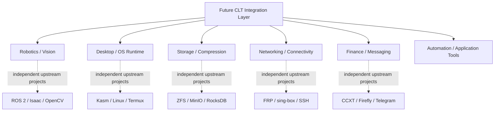

# CLT Core System — Sovereign Technology Architecture Map

[](#proof-of-concept--enterprise-customization-readiness)
[](#8-testing--verification)

**CLT Core System is a documentation-only architecture map for organizing potential open-source building blocks across the Cloudy_Lap_top (CLT) ecosystem.**

The repository currently contains one README file. It does not contain a runtime, integration code, orchestration engine, deployment workflow, tests, or packaged software. The third-party projects listed below are independent upstream projects and are not owned by this repository.

## 1. Project Overview & Problem Statement

A broad technology portfolio can become difficult to navigate when robotics, desktop environments, storage, networking, automation, financial systems, and messaging tools are evaluated separately. This document groups candidate open-source building blocks by architectural layer and describes where they might fit.

It is a planning/catalog document, not proof that the components are integrated or deployed.

### Conceptual architecture



No integration contracts, service boundaries, data schemas, or runtime connections are implemented here.

## 2. Tech Stack & Versions

No application tech stack or supported versions are declared by this repository. The README catalogs candidate upstream technologies by category:

| Layer | Candidate upstream projects (not integrated) |
|---|---|
| Robotics and computer vision | ROS 2, Isaac Gym, YOLOv7, OpenCV |
| Desktop / OS environments | v86, KasmVNC, Linux, Termux, Redroid |
| Storage and compression | ZFS, LZ4, Brotli, MinIO, RocksDB |
| Networking and connectivity | sing-box, FRP, Shadowsocks, V2Ray, SSH tooling |
| Finance and messaging | CCXT, Freqtrade, Baileys, python-telegram-bot, Firefly III |
| Automation | n8n, Activepieces, Ansible |
| Application development | Flutter, FastAPI, Tauri, Next.js |
| Security analysis | SQLMap, Nuclei, KICS |

The versions, licenses, maintenance status, hardware requirements, and compatibility of each upstream project must be checked at its official source before adoption.

## 3. Prerequisites & Dependencies

There are no software prerequisites or runtime dependencies for this repository because it contains documentation only.

Any future implementation must define:

- A selected set of upstream components and supported versions.
- Hardware and operating-system requirements for each layer.
- License compatibility and attribution obligations.
- A dependency inventory and update policy.
- Network, privacy, and data-handling boundaries.

## 4. Installation & Local Setup

Clone the documentation repository:

```bash
git clone https://github.com/zopair/CLT-Core-System.git
cd CLT-Core-System
```

There is no application to install or start. No Docker, package-manager, or deployment command is currently supported by this repository.

## 5. Environment Variables

No environment variables, credentials, API keys, or secrets are defined.

Do not add third-party tokens, cloud credentials, exchange keys, messaging tokens, or device credentials to this architecture catalog.

## 6. Usage Guide & Core Features

### A. Technology discovery

Use the layer table as a shortlist for technical evaluation. It is not a procurement list or a recommendation to install every component.

### B. Architecture evaluation

Before combining any projects, document:

- The specific use case and expected outcome.
- The API/protocol boundary between components.
- Data ownership, retention, and encryption requirements.
- Resource and hosting constraints.
- License compatibility and maintenance health.
- Operational responsibility and failure handling.

### C. Safe connectivity and execution environments

Networking and virtual-environment projects should be evaluated for legitimate connectivity, privacy, resilience, and authorized testing. Do not treat the catalog as instructions to evade access controls, conceal unauthorized activity, or bypass service restrictions.

### D. Financial and messaging integrations

Exchange, payment, financial-ledger, and messaging projects require separate account authorization, legal review, and secure credential handling. No exchange, wallet, bank, or messaging account is connected by this repository.

### E. No automation is implemented

The previous strategic directive addressed to a specific AI assistant is not an executable system contract. There is no automated scanner, repository monitor, agent dispatcher, budget controller, or guarantee of complete task execution in this repository.

## 7. Live Demo & Screenshots

No live application, dashboard, API, or hosted demo is deployed. The only deliverable is this architecture catalog.

## 8. Testing & Verification

There is no source code, test suite, CI workflow, static analysis, or deployment process in the current repository tree.

A future implementation should add tests and CI alongside the first runnable module. A documentation-only catalog cannot demonstrate integration correctness or operational reliability.

## Proof of Concept & Enterprise Customization Readiness

**Status: Architecture catalog / planning document only.**

| Capability | Current state |
|---|---|
| Technology-layer catalog | Documented |
| Upstream component shortlist | Documented; versions and licenses require individual verification |
| Cross-project integration | Not implemented |
| Runtime / orchestrator | Not implemented |
| Data and API contracts | Not defined |
| Security / access policy | Not implemented |
| Deployment | Not configured |
| Tests / CI | Not present |
| Project license | No root `LICENSE` file present |

### Readiness gates

1. Convert the catalog into a prioritized component shortlist tied to actual user requirements.
2. Verify each upstream project's current license, release, maintenance status, and compatibility.
3. Define one small end-to-end integration with explicit APIs and acceptance tests.
4. Establish resource, data, security, and failure boundaries before adding automation.
5. Keep third-party upstream code and ownership attribution separate from CLT project authorship.

## Intellectual Property & Authorship

Requested project attribution: **Aly Hussein Zopair (علي حسين زبير ALY HUSSEIN ZOPAIR)**.

**Provenance conflict requiring resolution:** the previous README identified `Prince Sultan` and `Al-Zubair Tec Investment` as owner/organization. That identity is not supported by the current repository account context. This document does not claim exclusive ownership of third-party upstream projects listed in the catalog.

This notice does not create a software license or override any upstream project's license, trademarks, or intellectual property rights.
